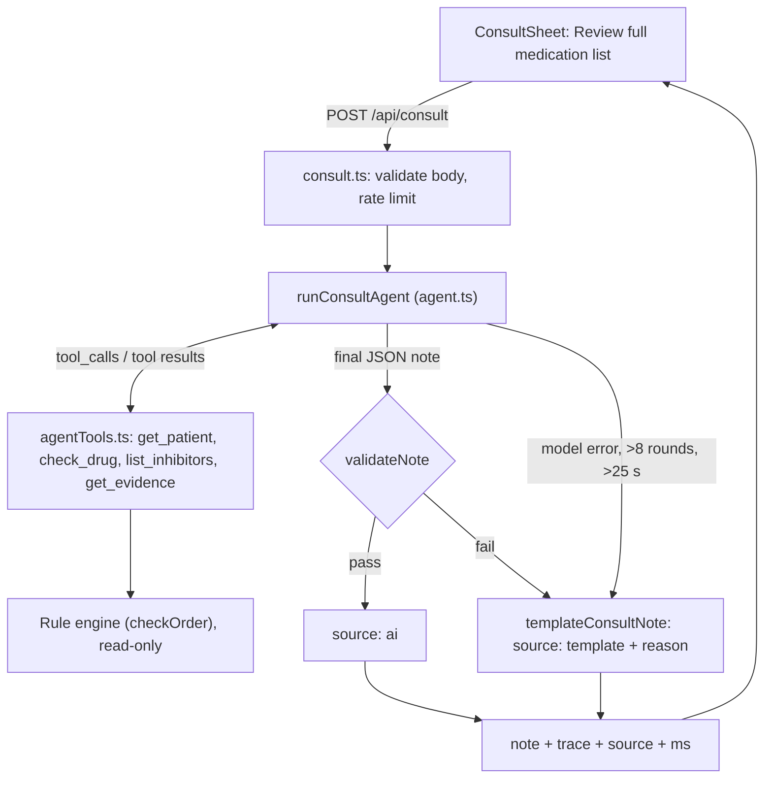

# Consult agent design

Source of truth: `requirements.md` (R45–R56) and brief 12 (`.kiro/briefs/mithuna-12-consult-agent.md`). Where the brief and a requirement differ, **the requirement wins**; each difference is marked **Brief vs requirement** under the section it affects and collected at the end.

Principle: the rule engine decides everything (R34). The agent calls deterministic tools, then writes up what they returned. Deterministic code checks the write-up. If any check fails, a deterministic Template note is shown.

Server-path rules from brief 09 apply to every file here: relative imports end in `.js`, JSON imports use `with { type: 'json' }`, no `@/` alias, no `temperature` field.

## Diagram

## 1. Tools (`web/api/_lib/agentTools.ts`)

Pure functions, no network. The patient (genotypes and meds) and the optional `addedDrug` come from the request body and are held in a `ctx` object. Tools read `ctx`; the model supplies only a drug name. Tools never write to `ctx` or to engine data.

| Tool | Args | Returns |
|---|---|---|
| `get_patient` | none | `{ name, cyp2d6, cyp2c19, meds, addedDrug }` |
| `check_drug` | `{ drug }` | The engine's assessment for that drug, run against the full list (`checkOrder`). Includes drug, gene, genotype and adjusted phenotype, genotype and adjusted activity score, inhibitor, confidence, alert level, recommendation text, strength, inhibitor note, label note, population, fixed GREY text where it applies, and requirement IDs. A drug not on the list and not the added drug returns an error. |
| `list_inhibitors` | none | CYP2D6 inhibitors on the list, each with its FDA class from `data/inhibitors.json`. |
| `get_evidence` | `{ drug }` | Guideline name, URL, fetched date and strength, taken from the assessment's source. |

`runTool(name, args, ctx)` returns `{ ok: true, result }` or `{ ok: false, error }`. An unknown tool name or bad arguments return `ok: false` to the model; they do not abort the run. OpenAI-format tool definitions (JSON Schema parameters) are exported from the same file.

There is no tool that creates, changes or suppresses an alert, and none will be added.

**Brief vs requirement (R46, R56):** the brief says `check_drug` returns a "compact form" with a fixed field list. R46 says the assessment is returned unchanged, and R56 needs qualifier fields the brief's list omits (population, the R17 "Different guidance contexts" text, the R20 second recommendation, the fixed GREY text). So `check_drug` may select fields to save tokens, but it must copy values verbatim (no rewording, rounding or recomputation) and must always include every field that validation reads (alert, recommendation, both phenotypes, qualifiers, population, fixed GREY text, requirement IDs).

Satisfies: R45 (tools cover every list drug plus the added drug), R46, R54 (read-only), R34.

## 2. Agent loop (`web/api/_lib/agent.ts`)

`runConsultAgent(ctx, deps)`. `deps` is injected for tests: `fetch`, `now`, and the model list from `llmConfig()`.

1. Messages: a system prompt and a user message with the patient name and the number of medications (list plus added drug).
2. POST `${LLM_BASE_URL}/chat/completions` with `{ model, messages, tools, tool_choice: "auto", max_tokens: 1200 }`.
3. If `finish_reason` is `tool_calls`, this is one **round**. Run every call in the message with `runTool` (parallel calls in one turn count as one round). Append the assistant message with its `tool_calls`, then one `{ role: "tool", tool_call_id, content }` per call. Loop.
4. Otherwise, treat the message content as the final note (JSON only, see section 3) and validate it.
5. Record a trace entry per tool call: `{ id: tool_call_id, tool, args, summary, ms }`, e.g. `check_drug(codeine) → RED · Avoid codeine`. Trace order is call order.

Limits (R51):

| Limit | Value | Result |
|---|---|---|
| Tool-call rounds | more than 8 (the 9th tool-calling turn fails) | Template, reason "max rounds" |
| Whole run | 25 s | Template, reason "timeout" |
| One model call | 8 s, capped by the time left in the run | Try next model; if none left, Template |
| Model error | HTTP error, empty reply, or Manifest text (`[🦚 Manifest`) | Try next model in `LLM_MODEL`; if none left, Template, reason "model error" |

The deadline is checked before each model call and tool batch. A final-answer turn after round 8 is allowed. The trace gathered so far is always returned, including on failure (R53).

System prompt essentials: draft a pharmacogenomics consult note for a pharmacist to review; call `check_drug` for every medication and the added drug; cite the tool_call ids behind each factual sentence; state only what tools returned and keep each drug's action; never call anything safe; add no drugs, doses or numbers that are not in tool results; output only the JSON.

Final message shape:
`{ "sections": [ { "heading": string, "sentences": [ { "text": string, "cites": [tool_call_id, ...] } ] } ] }`
with headings "Pharmacogenomic summary", "Medication-specific findings", "Drug–drug–gene interactions", "Recommendations for prescriber". Invalid JSON fails validation.

**Brief vs requirement:** the brief's 8 s per-call timeout is not in the requirements; it is kept as an implementation detail under the R51 25 s cap.

Satisfies: R45, R46, R51 (rounds, timeout, model failure), R53 (trace kept on failure), R54, R34.

## 3. Validation (`validateNote(note, trace, assessments)`)

Pure, deterministic code; no model is used for any check (R47). Any failure returns a named reason and triggers the Template (section 4). The checks:

**Citation check (R47).** Each sentence is scanned by deterministic matchers for structured claims: alert level (RED, YELLOW, GREEN, GREY), recommendation text, phenotype, diplotype, activity score, inhibitor class, and qualifiers (reduced confidence, inhibitor note, label note, population). A sentence with a claim must cite at least one id, every cited id must exist in this run's trace, and **the cited call's result must contain the claim** (and for a drug-specific claim, the cited `check_drug` must be for that drug). Matching is case-insensitive against the structured fields.

**Drug-name check (R49).** Drug names are detected with `KNOWN_DRUGS` (`fhir.ts`). Allowed: medications on the list, the added drug, and drugs appearing in returned CPIC/FDA recommendation text, the last only when they sit inside a quoted recommendation sentence. Anything else fails.

**Number check (R50).** Every number in the note must appear in a tool result from this run. Exempt: counts of medications reviewed, timestamps in the header, citation markers (trace step indices), gene and allele identifiers (CYP2D6, `*4`, `*1x2`), requirement IDs (R10), and fixed texts copied verbatim from tool output.

**Wording check (R33).** Fails on safe, safely, safety, unsafe, seguro, seguridad, except inside the exact strings "not the same as safe" and "no es lo mismo que seguro".

**RED/YELLOW coverage (R48).** Every RED or YELLOW drug must be addressed and keep its action word (RED: avoid; YELLOW: dose, adjust or titration wording).

**R55 coverage.**
- Every drug reviewed (list plus added drug) must have a successful `check_drug` result in the trace and appear in the note with the engine's result.
- GREY: the sentence contains the R7, R8 or R18 fixed text (from `messages.ts`) unchanged.
- GREEN: the sentence uses exactly "No supported PGx alert (not the same as safe)", labels it a genotype result only, and no sentence states or implies the whole list is cleared (e.g. "all clear", "no issues on the list").

**R56 coverage.** Each non-empty qualifier string in a drug's `check_drug` result must appear (case-insensitive substring) in that drug's sentences: genotype and adjusted phenotype side by side (R19), "reduced confidence" with both recommendations (R20), the poor-metabolizer inhibitor note (R21), the atomoxetine "Different guidance contexts" text (R17), the omeprazole–clopidogrel label note (R28), and the population for atomoxetine and clopidogrel (R26, R27).

**Brief vs requirement:**
- R47: the brief only checks that a cited id exists and that a factual sentence has some cite. R47 also requires the cited result to contain the fact. The stronger rule is used.
- R49: the brief allows drugs "named in the recommendation texts". R49 allows alternatives only inside quoted CPIC/FDA text. The stricter rule is used.
- R50: the brief checks against `JSON.stringify(trace results)` only. R50 adds the exemption list above.
- R33: the brief checks "safe"/"seguro". R33 also covers safely, safety, unsafe, seguridad, and the Spanish exception. R33 is used.

Satisfies: R33, R47, R48, R49, R50, R55, R56, R34.

## 4. Template fallback (`templateConsultNote(assessments)`)

Built only from engine assessments; no model text. Same four section headings. One sentence per reviewed drug, from engine fields, in this order within the section: the engine's order of assessments (the agent does not reorder; R54). Each sentence carries the engine's alert level and action, and the qualifiers required by R56 and R55 (both phenotypes, reduced confidence with both recommendations, inhibitor note, "Different guidance contexts", label note, population, fixed GREY text, GREEN wording with "genotype result only"). The Template header carries the "Draft — pharmacist review required" label.

Returned with `source: "template"` and a `reason`: "max rounds", "timeout", "model error", "llm unavailable", or "validation: <check name>".

R47, R49 and R50 do not apply to the Template (no model text). R33, R48, R52, R53, R55 and R56 do, and unit tests run those validators against Template output.

**Brief vs requirement (R53):** the brief points Template cites at "synthetic trace ids". R53 says the trace shown is the agent's real trace up to the point of failure. Resolution: keep the real trace untouched, and append synthetic steps flagged `synthetic: true` (labeled "template, not an agent call" in the UI) so every Template cite resolves without altering the real trace.

Satisfies: R51, R33, R48, R52, R53, R55, R56, R54.

## 5. Endpoint (`web/api/consult.ts`)

**Request:** `POST { patient: { id, name, cyp2d6?, cyp2c19?, meds: string[] }, addedDrug?: string }`

**Response (200):** `{ note, source: "ai" | "template", reason?, trace, model?, ms }`. `note` carries the "Draft — pharmacist review required" label (R52). `trace` is returned for both sources (R53). `model` is present only for `ai`.

**Errors and edge cases:**

| Case | Result |
|---|---|
| Body missing or malformed (no patient, `meds` not a string array, wrong types) | 400 |
| Rate limited (`clientIp` / `isRateLimited` from `llm.ts`) | Same status and shape as the other LLM endpoints |
| `OPTIONS` | CORS preflight, same headers as the other endpoints |
| LLM key missing or model unavailable | 200, `source: "template"`, reason "llm unavailable" |
| Model failure, >8 rounds, >25 s, validation failure | 200, `source: "template"`, with `reason` and the partial trace |

The endpoint only reads the request and calls the engine; it persists nothing and has no send, sign or file path (R52). LLM env vars stay server-only.

Open point to confirm when building: the serverless function's max duration must be above 25 s, otherwise the platform will cut the run before R51's own timeout fires.

Satisfies: R45, R51, R52, R53, R54.

## 6. ConsultSheet UI

Opened by a "Review full medication list" button in the verdict-bar actions, next to "Inspect evidence". shadcn `Sheet`, right side, about 720 px wide, `overscroll-behavior: contain`.

- **Header:** "Pharmacist consult draft", the badge "Draft — pharmacist review required" (R52), and a source tag: "AI agent · {model}" or "Template". For Template, the reason is shown beside the tag.
- **Running state:** skeleton plus "Agent reviewing {n} medications…" (n = list plus added drug).
- **Left column, trace (R53):** numbered steps showing tool, arguments and short summary, revealed with a 100 ms stagger (display only; respects reduced motion). Shown for both AI and Template runs; synthetic Template steps are visibly labeled.
- **Right column, note:** sections and sentences. Each citation is a chip `[n]`. Hover or focus highlights the matching trace step; click scrolls to it. Chips are real links/buttons so they work by keyboard.
- **Copy note:** copies plain text with citations and the draft label. This is a local clipboard action only.
- **No send, sign or file action** anywhere in the sheet (R52).
- **Alerts untouched (R54):** the sheet receives the engine's alerts read-only and holds its own state. Opening, running or closing it does not change the main view's alerts or their order.

Satisfies: R52, R53, R54, R45 (button runs the review over the full list).

## Requirement coverage

| R | Section |
|---|---|
| R45 | 1, 2, 5, 6 |
| R46 | 1, 2 |
| R47 | 3 |
| R48 | 3, 4 |
| R49 | 3 |
| R50 | 3 |
| R51 | 2, 4, 5 |
| R52 | 4, 5, 6 |
| R53 | 2, 4, 5, 6 |
| R54 | 1, 2, 4, 5, 6 |
| R55 | 3, 4 |
| R56 | 3, 4 |

## Brief vs requirement summary

| Topic | Brief | Requirement (wins) |
|---|---|---|
| check_drug output | Compact fixed field list | Unchanged assessment (R46); must carry all R56 qualifier fields |
| Citation validity | Id exists in trace; factual sentence has a cite | Cited result must contain the stated fact (R47) |
| Alternative drugs | Allowed if named in recommendation texts | Only inside quoted CPIC/FDA text (R49) |
| Number check | Against trace results only | Plus the R50 exemption list |
| Unsafe wording | "safe"/"seguro" | Full R33 word list and both exceptions |
| Template cites | Synthetic trace ids | Real trace kept (R53); synthetic steps appended and flagged |
| Per-call 8 s timeout | In brief only | Kept as an implementation detail under R51's 25 s |
